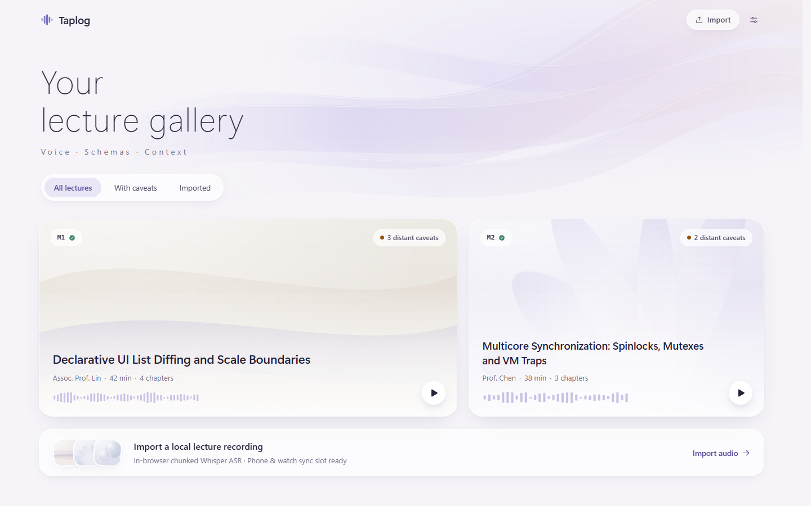
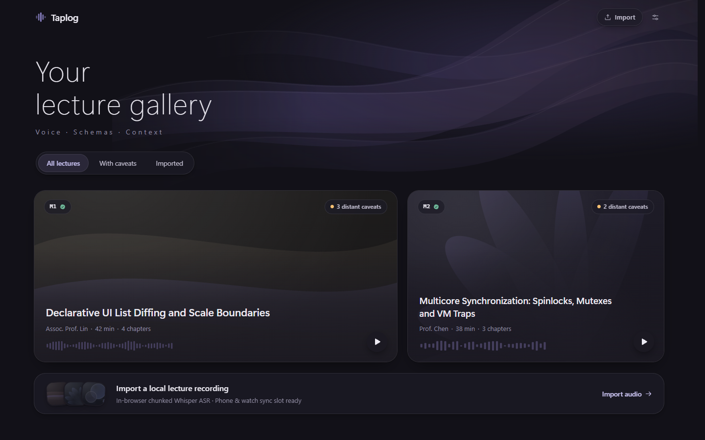
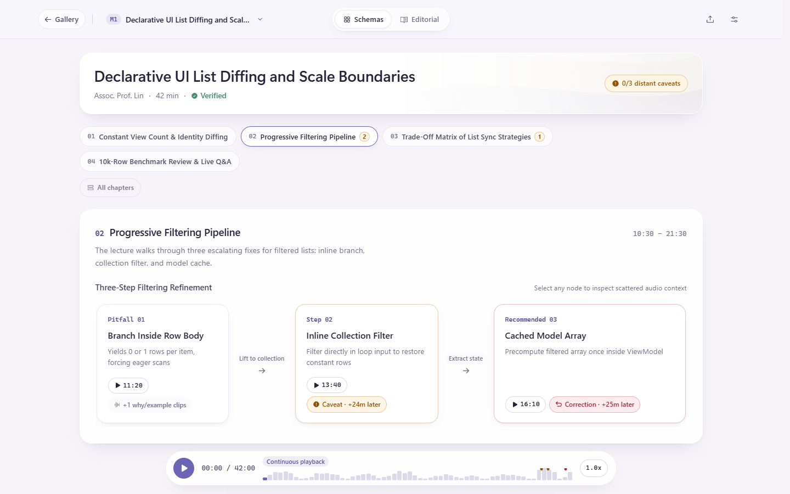
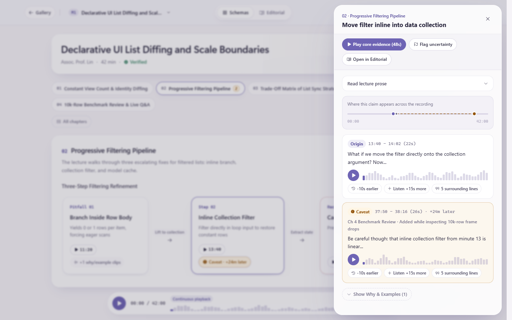
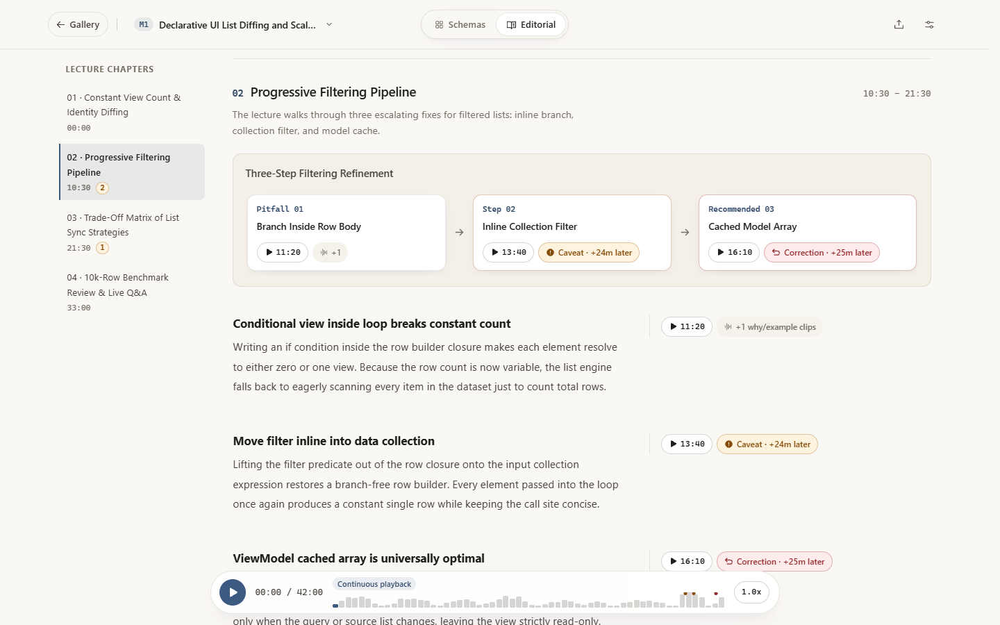
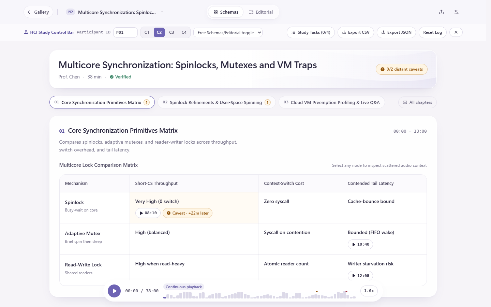

<div align="center">


# Taplog

**Traceable Visual Lecture Notes: Recover Context Scattered Across a Long Recording**

English | [简体中文](./README.zh-CN.md)

[](#where-your-data-lives)
[](#importing-your-own-recordings)
[](#keyboard-shortcuts--url-parameters)
[](./LICENSE)

<br />



</div>

---

## Why Taplog

Most AI lecture notes link each takeaway to a **single timestamp**. That assumes speakers finish every thought in one place.

In real lectures, they rarely do. A professor gives a clean recommendation at **13:40**, adds a performance boundary during a benchmark at **37:50** (`+24m later`), and walks back an earlier "always optimal" rule during Q&A at **41:05** (`+25m later`). When a student clicks `13:40` and hears a confident, complete sentence in the speaker's own voice, they walk away believing a half-truth with full confidence.

**Taplog** keeps the calm reading feel of visual lecture notes while linking every claim to all the moments where the speaker introduced it, constrained it, or revised it:

- **Glanceable risk separation**: Only high-risk revisions (`Caveat` and `Correction`) surface on the outer canvas with their time jump (such as `Caveat · +24m later`). Optional `Why` and `Example` clips stay quietly tucked away until you ask for them.
- **Bounded playback**: Playing an evidence clip automatically pauses at the end of that exact excerpt so a 45-minute recording never runs away in the background. You can expand backwards by `-10s`, listen `+15s` further, or peek at 5 surrounding transcript lines without leaving your place.
- **Zero-backend & local-first**: Runs completely in your browser with two built-in bilingual demo lectures and local WebAssembly Whisper transcription for your own recordings.

---

## Visual Tour

### 1. Quiet Cover Gallery (Light & Dark)

Every lecture opens as a calm Bento cover card with deterministic generative artwork (`dunes`, `petals`, `ribbon`, and `orbs`) paired across light and dark palettes. Cards stay free of text walls, showing only the title, speaker, duration, distant caveat count, miniature waveform, and a circular `PlayRing` for quick listening right from the shelf.

<table>
  <tr>
    <td width="50%">
      
      <p align="center"><sub>Mist Canvas (Light)</sub></p>
    </td>
    <td width="50%">
      
      <p align="center"><sub>Mist Canvas (Dark)</sub></p>
    </td>
  </tr>
</table>

### 2. Focused Visual Schemas (Level 2 · Default)

Opening a lecture brings you into a single-chapter focused view (with a one-click toggle to view all chapters at once). Instead of walls of prose, each chapter distills its argument into one of two predictable visual structures: a **Progressive Refinement Flow** or a **Multi-Dimensional Comparison Matrix**.



### 3. Slide-Over Trace Drawer & Bounded Listening (Level 3)

Click any diagram node, matrix cell, or margin badge to slide open the frosted **Trace Drawer** on the right without breaking your layout or scrolling away from the note:

- **50-minute mini timeline** showing how far apart the speaker's remarks sit across the full lecture
- **One-click `Play core evidence`** chaining the origin clip and distant caveats together with a skip notice in between
- **Expandable lecture prose** right inside the drawer when reading in Schema mode
- **Bounded clip cards** with truncated verbatim leads, interactive waveforms, `-10s earlier`, `Listen +15s more`, and `5 surrounding lines`



### 4. Warm Editorial Paper (Level 2 · Deep Reading)

Switch to **Editorial** in the top bar for long-form reading on warm archival paper (`#FAF8F4` light / `#151413` dark). Each chapter pairs a sticky table of contents, a compact linked diagram, a comfortable reading column (~66 characters wide), and a Tufte-style **Margin Rail** that keeps timestamps and caveat pills out of the prose.



### 5. Comparison Matrix & Discreet HCI Study Workbench

The product interface stays minimal by default. For coursework or user studies, append `?study=1` to the URL (or press `Ctrl + Shift + E` / `Cmd + Shift + E`) to reveal the **HCI Study Control Bar** and jump straight into a lecture:

- Switch cleanly between **C1 (Single-Anchor Baseline)**, **C2 (Layered Multi-Anchor)**, **C3 (Full Searchable Transcript)**, and **C4 (Pure Visual, No Audio)** over the exact same underlying lecture text
- Lock readers to Schemas or Editorial mode per experimental block
- Built-in **T1–T4 study tasks**, including two-step confidence ratings (before vs. after audio verification)
- One-click **CSV / JSON** behavioral log export



---

## Quick Start

### Requirements

- **Node.js 24+** and **npm 11+**
- A modern Chromium, Firefox, or Safari browser

### Install and Launch

```bash
git clone https://github.com/lingcang728/Taplog.git
cd Taplog
npm ci
npm run dev
```

Open `http://127.0.0.1:5173/` in your browser.

### First 2 Minutes in Taplog

1. **Browse the gallery**: Switch between `All lectures` and `With caveats`, or click the sliders icon in the top right to try `Light / Dark` themes and `English / 中文`.
2. **Inspect a distant caveat**: Click **M1 · Declarative UI List Diffing and Scale Boundaries**, open chapter **02 Progressive Filtering Pipeline**, and click the amber `Caveat · +24m later` card.
3. **Verify with bounded audio**: In the right drawer, click `Play core evidence` (or play any single clip). Playback stops automatically at the clip boundary and marks the excerpt `Verified`.
4. **Switch to Editorial Paper**: Click **Editorial** in the center switcher to read the full lecture prose with its synced margin rail.

### Built-in Demo Lectures

Both built-in lectures are available in full **English** and **Simplified Chinese** and work immediately without downloading external audio files (the player uses your browser's built-in speech synthesis alongside synchronized waveforms until you import a real recording):

| Code | Topic | Length | Highlights |
|---|---|---|---|
| **M1** | Declarative UI List Diffing and Scale Boundaries | 42 min | Baseline chapter with no revisions, `+24m` scale caveat, `+25m` Q&A correction, 3-strategy matrix |
| **M2** | Multicore Synchronization: Spinlocks, Mutexes and VM Traps | 38 min | Comparison matrix with `+22m` cloud VM preemption caveat and live Q&A revision |

---

## Importing Your Own Recordings

Click **Import** in the top bar (or the frosted import strip at the bottom of the gallery) to select any local `.mp3`, `.wav`, or `.m4a` lecture file:

1. Taplog decodes the audio and builds its waveform locally in your browser.
2. A dedicated Web Worker runs quantized Whisper (`onnx-community/whisper-tiny`) over **30-second sliding chunks** with overlap deduplication, removing the typical 10-minute short-clip limit.
3. Once finished, the draft lecture opens directly in your workspace with full playback and searchable timestamps.

> **Note on first transcription**: The first time you transcribe a local recording, your browser downloads the quantized Whisper model weights from Hugging Face and caches them locally. To serve the weights from your own static directory instead, copy `.env.example` to `.env` and set `VITE_TAPLOG_MODEL_PATH`.

The import sheet also reserves a connector card for future phone and wearable quick-mark sync.

---

## Where Your Data Lives

Taplog is **100% client-side** and requires no backend server or account:

- **Audio files & drafts**: Stay inside your current browser tab (cleared on page refresh) and are never uploaded to any server.
- **Whisper model cache**: Stored locally by the browser Cache API after the first local transcription.
- **Study telemetry**: Kept only in memory during your session until you explicitly click `Export CSV` or `Export JSON`.

---

## Keyboard Shortcuts & URL Parameters

### Keyboard Shortcuts

| Shortcut | Action |
|---|---|
| `Ctrl + Shift + E` / `Cmd + Shift + E` | Toggle the discreet HCI Study Control Bar |
| `Alt + 1` | Switch to **Schemas** view (inside a lecture) |
| `Alt + 2` | Switch to **Editorial** view (inside a lecture) |
| `Esc` | Close the open Trace Drawer, Import sheet, or Study Tasks panel |

### Direct URL Parameters

Useful for bookmarking a view or distributing balanced study links:

| Parameter | Values | Example |
|---|---|---|
| `lang` | `en`, `zh` | `?lang=en` |
| `theme` | `light`, `dark`, `system` | `?theme=dark` |
| `lecture` | `m1`, `m2` | `?lecture=m2` |
| `density` | `brief` (Schemas), `detailed` (Editorial) | `?lecture=m1&density=detailed` |
| `style` | `mist`, `paper` | `?lecture=m1&style=paper` |
| `study` | `1` | `?study=1&lecture=m1&cond=c2` |
| `cond` | `c1`, `c2`, `c3`, `c4` | `?study=1&lecture=m2&cond=c1` |

---

## Useful Commands

```bash
npm run dev      # Start local Vite dev server
npm run build    # Type-check with TypeScript and build production bundle to dist/
npm run preview  # Preview the production bundle locally
npm test         # Run unit tests with Vitest
```

---

## License

Released under the [MIT License](./LICENSE).
