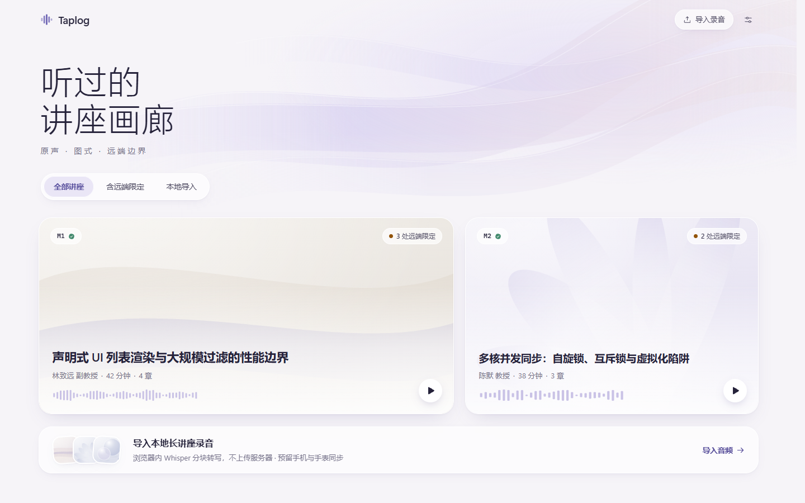
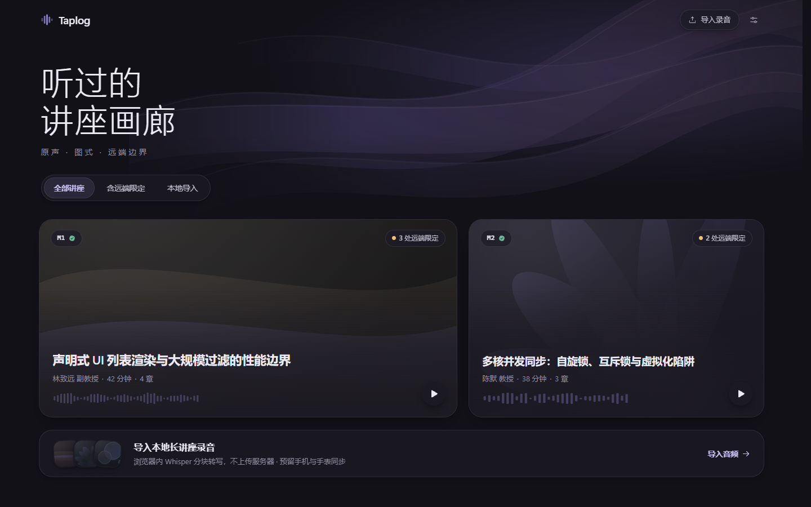
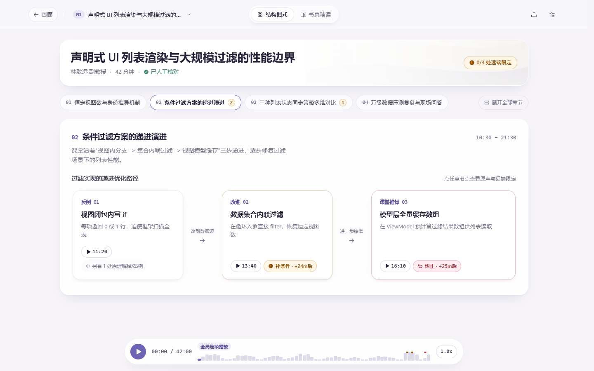
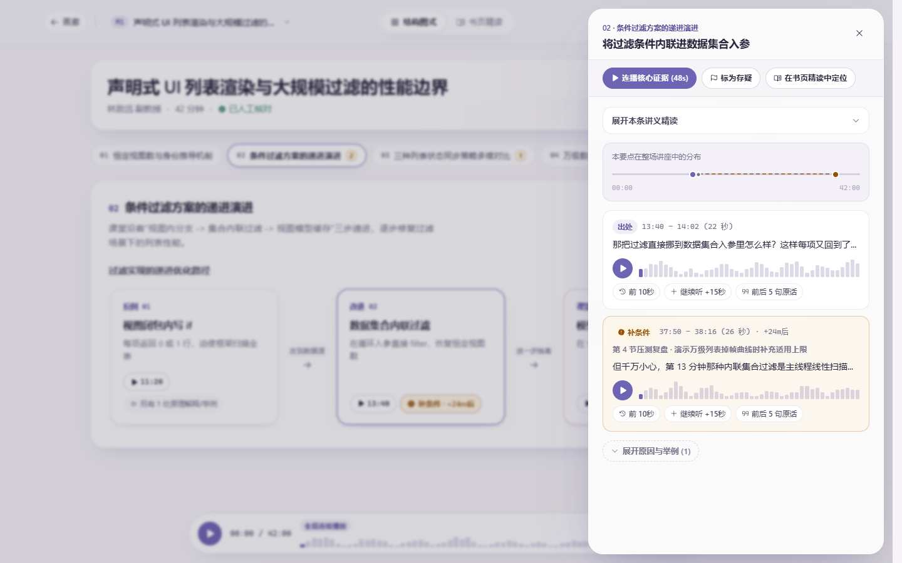
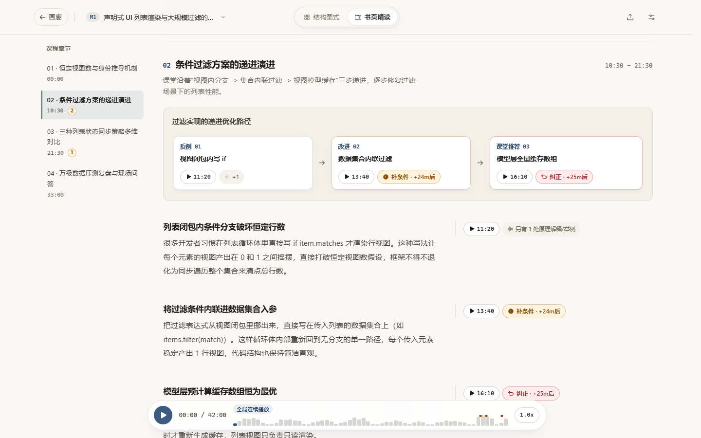
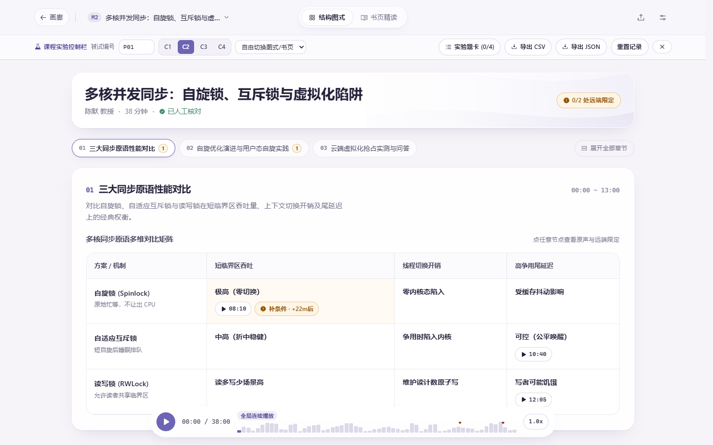

<div align="center">


# Taplog

**可溯源图文讲座纪要：帮读者找回分散在长录音里的关键上下文**

[English](./README.md) | 简体中文

[](#数据存储在哪里)
[](#导入本地长讲座录音)
[](#快捷键与直达链接参数)
[](./LICENSE)

<br />



</div>

---

## 为什么做 Taplog

大多数 AI 讲座纪要只给每条要点配**一个时间戳**。它默认讲者会把一件事在同一个时间段里讲完。

真实的技术讲座与演讲往往不是这样：讲者在 **13:40** 给出了一条干脆的推荐做法，直到 **37:50**（`+24m后`）做压测复盘时才补上“超过 5000 条会卡死主线程”的适用边界，又在 **41:05**（`+25m后`）的现场问答里推翻了前面“恒为最优”的说法。读者点开 `13:40` 听到一句语气笃定的原声，反而更容易带着十足把握记住半句真话。

**Taplog** 保留安静克制的图文阅读体验，同时把一条要点散落在整场录音里的出处、补条件、纠正与解释串联在一起：

- **外层只报高风险，不造噪音**：只有会改变结论的「补条件」与「纠正」会在外层亮起跨度角标（如 `补条件 · +24m后`）；不改变结论的「解释原因」与「举例」默认静默折叠。
- **有界片段回听，到点自动暂停**：点击原声只播放当前证据区间 `[startMs, endMs]` 并自动停下，不会把 40 分钟录音无休止播下去；需要前后语境时再按需点 `前 10秒`、`继续听 +15秒` 或展开 `前后 5 句原话`。
- **纯前端本地运行，开箱即用**：不需要启动后端或登录账号，内置两场完整双语示范讲座，也支持直接在浏览器里用 Whisper 分块转写本地长录音。

---

## 界面一览

### 1. 一级页面：安静克制的讲座封面画廊（浅色 / 深色）

打开 Taplog 首先看到的是低饱和雾紫飘带封面与 Bento 讲座卡片墙。每场讲座根据唯一标识生成固定的柔和几何封面（`dunes` 沙丘、`petals` 花瓣、`ribbon` 丝带、`orbs` 柔光球），并配备亮暗两套成对色板。卡片上不堆砌长文案，只保留标题、主讲与时长、远端限定提示、微波形和可直接试听的环形播放键 `PlayRing`。

<table>
  <tr>
    <td width="50%">
      
      <p align="center"><sub>雾紫画布（浅色）</sub></p>
    </td>
    <td width="50%">
      
      <p align="center"><sub>雾紫画布（深色）</sub></p>
    </td>
  </tr>
</table>

### 2. 二级页面：单章聚焦的结构图式（默认视图）

点进任意讲座，默认进入干净的单章聚焦图式视图（随时可一键切换「展开全部章节」）。每章固定使用「递进推演链」或「多维对比矩阵」两种清晰结构呈现论证骨架，远端风险角标直接落在对应节点上。



### 3. 三级交互：右侧滑出溯源与有界原声抽屉

点击任意图节点、矩阵单元格或侧边批注，右侧平滑展开毛玻璃溯源抽屉，既不撑裂主图排版，也不丢掉当前阅读位置：

- **50 分钟微缩分布条**：一眼看清这条要点的原话与后续补条件隔了多久
- **一键「连播核心证据」**：自动按顺序串播原处与远端限定，并在跨时段跳转时提示跨度
- **就地展开本条讲义精读**：在图式视图里就能随时展开对应段落，或一键定位到书页精读
- **有界片段微播放器**：展示跨时间语境桥接与 15-20 字原话前导气味，播完自动标记 `已核对`



### 4. 二级页面：暖白书页精读（Editorial Paper）

点击顶栏的「书页精读」，界面自动切换为暖白书页底色（`#FAF8F4`，深色为暖炭黑 `#151413`）。页面采用「左侧章节目录 + 中栏 66 字宽精读讲义（内嵌微缩联动图）+ 右侧溯源批注轨」布局，把时间戳与预警标签移出正文行内，长文阅读更轻松。



### 5. 多维对比矩阵与隐蔽式实验台

日常使用时界面保持纯粹极简，不显示任何实验控件。在用户研究或测试场景下，通过访问 `?study=1`（或按 `Ctrl + Shift + E` / `Cmd + Shift + E`）即可唤出「实验控制栏」并直达指定讲座：

- 在完全同一份讲义与图式文案上切换 **C1（单点溯源基线）**、**C2（分层多点溯源）**、**C3（全文转写对照）**、**C4（纯图文无溯源）**
- 支持按实验组锁定在「结构图式」或「书页精读」视图
- 内置 **T1–T4 实验题卡**（含先看图文初判、再听原声核实的 T2 两步信心打分）
- 支持一键导出 **CSV / JSON** 行为日志



---

## 快速开始

### 环境要求

- **Node.js 24+** 与 **npm 11+**
- 现代桌面或移动浏览器（Chrome / Edge / Firefox / Safari）

### 安装与启动

```bash
git clone https://github.com/lingcang728/Taplog.git
cd Taplog
npm ci
npm run dev
```

启动后在浏览器访问 `http://127.0.0.1:5173/`。

### 首次打开可以怎么体验（2 分钟）

1. **逛一遍封面画廊**：试试筛选胶囊「全部讲座 / 含远端限定」，或点右上角外观按钮切换「浅色 / 深色」与「中文 / English」。
2. **体验远端限定发现**：点进 **M1 · 声明式 UI 列表渲染与大规模过滤的性能边界**，切到 `02 条件过滤方案的递进演进`，点击带有琥珀色 `补条件 · +24m后` 的卡片。
3. **试听有界原声**：在右侧滑出的抽屉里点「连播核心证据」或单条播放按钮，感受片段到点自动暂停、`前 10秒 / 继续听 +15秒` 扩窗以及播完自动标为 `已核对`。
4. **切到书页精读**：点顶栏中间的「书页精读」，体验暖白书页排版与右侧批注轨联动。

### 内置双语示范讲座

应用内置两场中英双语示范讲座，无需额外准备音频即可体验完整交互（未导入外部音频文件时会自动使用浏览器自带语音朗读并同步驱动波形）：

| 编号 | 讲座主题 | 时长 | 内容特点 |
|---|---|---|---|
| **M1** | 声明式 UI 列表渲染与大规模过滤的性能边界 | 42 分钟 | 含无修正对照章节、`+24m` 压测补条件、`+25m` 问答纠正与三方案对比矩阵 |
| **M2** | 多核并发同步：自旋锁、互斥锁与虚拟化陷阱 | 38 分钟 | 含多核锁多维对比矩阵、`+22m` 云虚拟机抢占补条件与现场问答修正 |

---

## 导入本地长讲座录音

点击顶栏的「导入录音」（或画廊底部的毛玻璃导入条），选择本地 `.mp3`、`.wav` 或 `.m4a` 讲座文件：

1. 浏览器在本地完成音频解码并生成波形。
2. 独立 Web Worker 加载量化 Whisper 模型（`onnx-community/whisper-tiny`），按 **30 秒滑窗分块**识别带时间戳的逐字稿并自动去重接缝，不受 10 分钟时长限制。
3. 转写完成后自动在阅读台打开讲座草稿，可直接播放波形与检索时间戳。

> **首次转写说明**：第一次在本地转写录音时，浏览器会自动从 Hugging Face 拉取一次量化 Whisper 模型权重并缓存到本地。如果你想改用本地静态目录托管模型文件，可复制 `.env.example` 为 `.env` 并配置 `VITE_TAPLOG_MODEL_PATH`。

导入面板同时预留了手机与手表端同步录音的扩展入口卡片。

---

## 数据存储在哪里

Taplog 是**纯前端本地运行**的应用，不需要后端服务，也不收集账号信息：

- **本地导入的音频与草稿**：仅保留在当前浏览器标签页内存中（刷新页面后会清空），不会上传到任何服务器。
- **Whisper 模型缓存**：首次转写下载后缓存在浏览器本地缓存（Cache API）中，后续转写直接复用。
- **实验记录与打分**：仅暂存在当前页面内存中，直到你手动点击「导出 CSV」或「导出 JSON」保存到本地。

---

## 快捷键与直达链接参数

### 常用快捷键

| 快捷键 | 功能 |
|---|---|
| `Ctrl + Shift + E` / `Cmd + Shift + E` | 开启或关闭隐蔽式实验控制栏 |
| `Alt + 1` | 切至「结构图式」视图（讲座详情页内） |
| `Alt + 2` | 切至「书页精读」视图（讲座详情页内） |
| `Esc` | 依次关闭右侧溯源抽屉、导入面板或实验题卡 |

### URL 直达参数

适合收藏特定阅读状态，或在用户测试中直接分发带实验条件的链接：

| 参数 | 可选值 | 示例 |
|---|---|---|
| `lang` | `zh`、`en` | `?lang=zh` |
| `theme` | `light`、`dark`、`system` | `?theme=dark` |
| `lecture` | `m1`、`m2` | `?lecture=m2` |
| `density` | `brief`（结构图式）、`detailed`（书页精读） | `?lecture=m1&density=detailed` |
| `style` | `mist`（雾紫）、`paper`（书页） | `?lecture=m1&style=paper` |
| `study` | `1` | `?study=1&lecture=m1&cond=c2` |
| `cond` | `c1`、`c2`、`c3`、`c4` | `?study=1&lecture=m2&cond=c1` |

---

## 常用命令

```bash
npm run dev      # 启动本地开发服务器
npm run build    # 运行 TypeScript 类型检查并打包静态产物到 dist/
npm run preview  # 本地预览生产构建产物
npm test         # 运行 Vitest 单元测试
```

---

## 开源协议

基于 [MIT License](./LICENSE) 开源。
